# Colok

Public power outlets, Wi-Fi, water refills and seating, on a map that the people who pass by keep true. On BOT Chain.

Anyone can add a spot. Other wallets confirm it is still there ("Still here") or report a problem. Each spot has a health score from −3 to +3; two confirmations from other people make it **Verified**, 90 days without a confirmation make it **Stale**, and a score of −2 makes it **Reported gone**. The contract computes the status, so every reader gets the same answer.

*Colok* comes from *colokan*, Indonesian for a wall socket.

- Product scope and decisions: [PRD.md](PRD.md)
- Status and what was verified: [PROGRESS.md](PROGRESS.md)
- Network: BOT Chain Mainnet, chain ID 677 — <https://botchain.ai> · <https://scan.botchain.ai>


## Screenshots

Taken from the local chain with the sample spots that `npm run seed:local` creates, plus the actions shown here (one confirmation, one added spot). None of the spots on these maps is a real, checked place, and none of them is on a public network. The map tiles are real OpenFreeMap tiles of central Jakarta.

### Finding a spot

| Spot detail | Nearby list, the full alternative to the map |
|---|---|
|  | 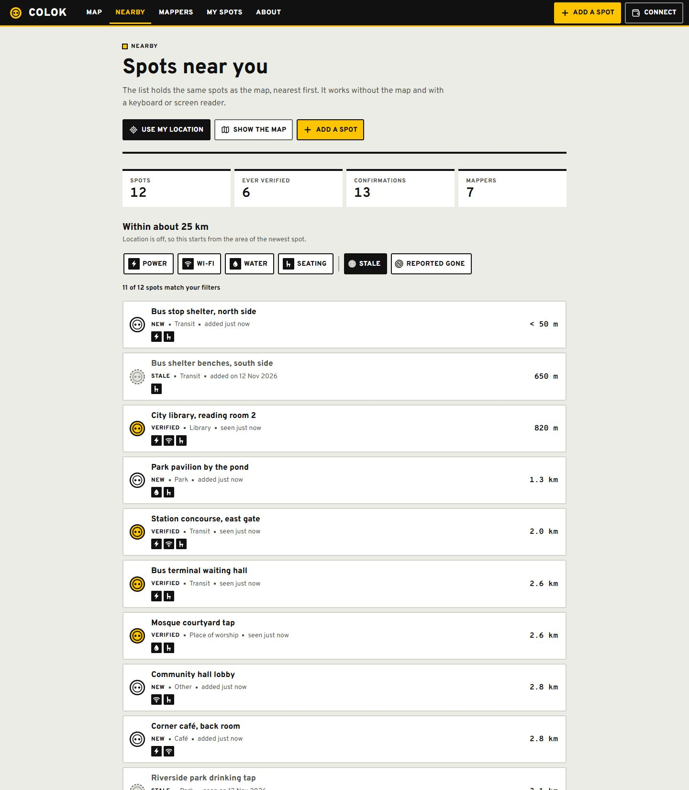 |

### Confirming and reporting

| Before a wallet's first confirmation | After two people confirmed |
|---|---|
| 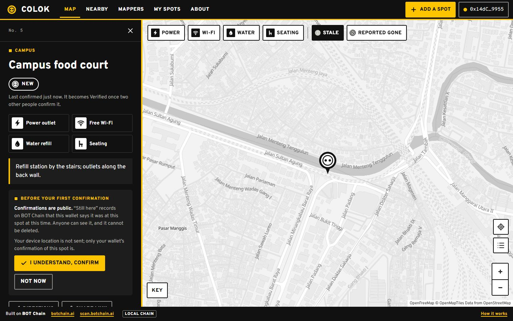 | 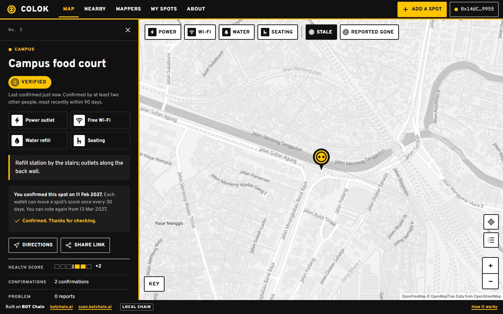 |

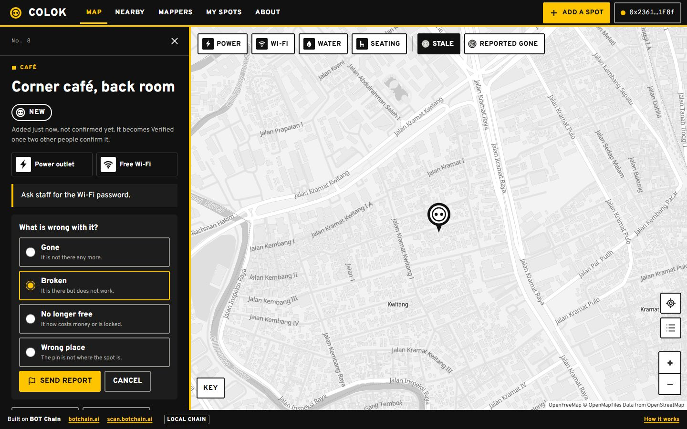

### Adding a spot

| Crosshair and form | Added |
|---|---|
|  | 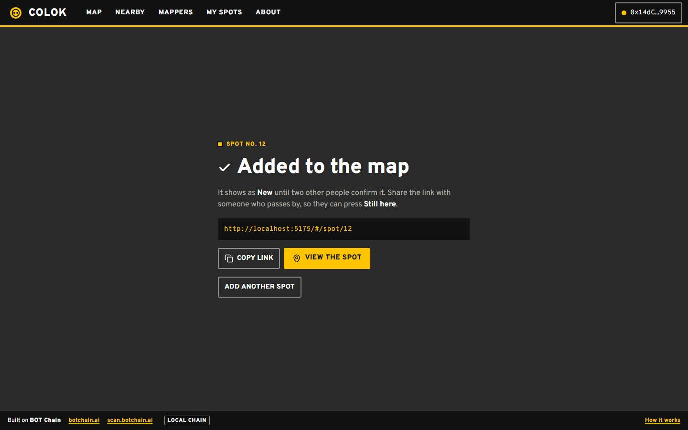 |

### People and wallet

| Mappers | My spots |
|---|---|
| 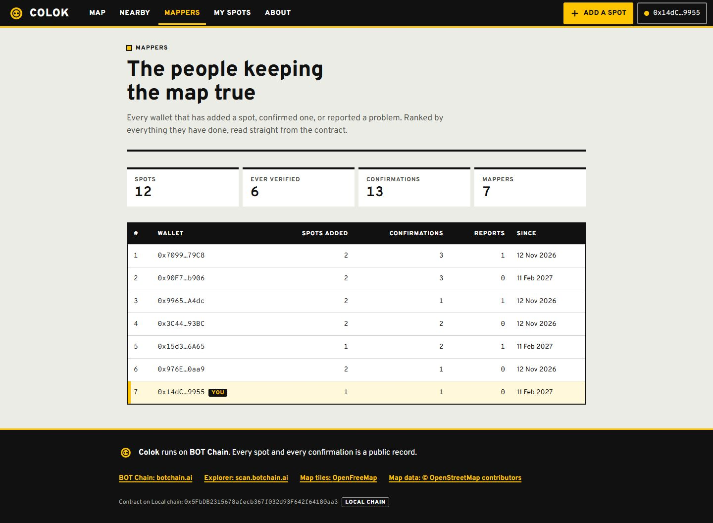 | 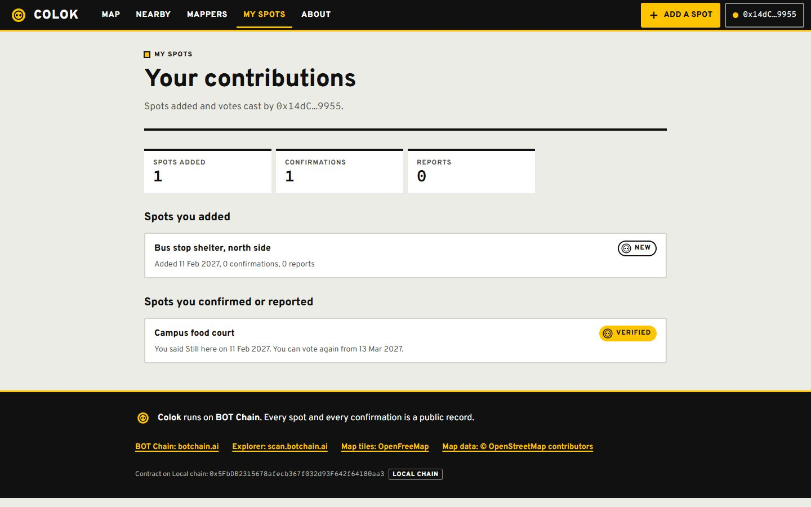 |

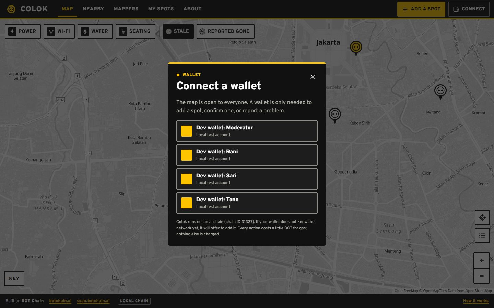

### How it works


### Phone and tablet

| Map at 375 px | Spot at 375 px | Menu at 375 px |
|---|---|---|
| 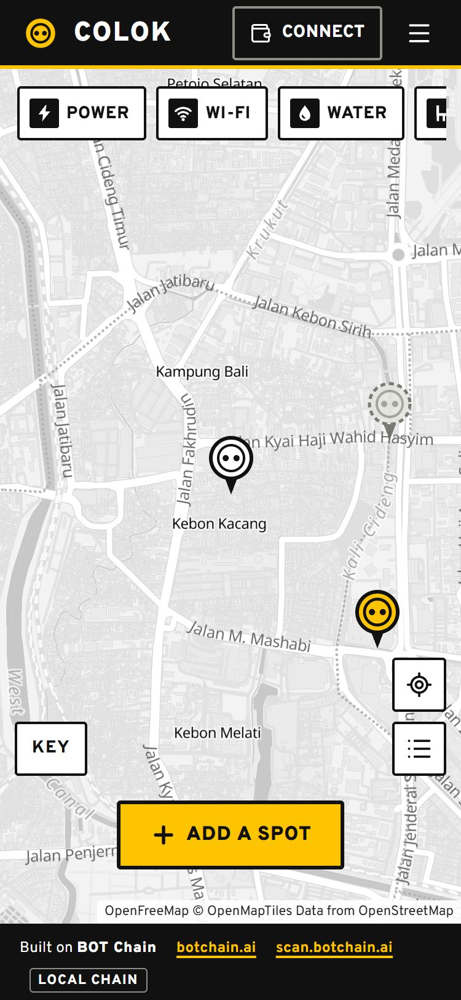 | 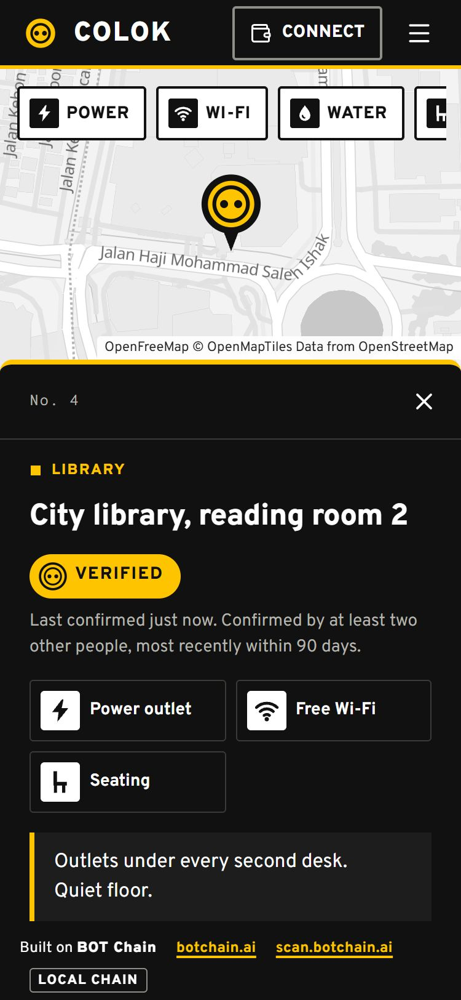 | 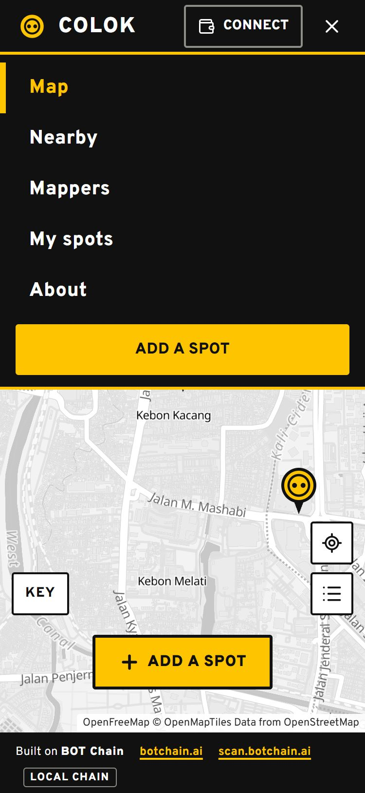 |

| Add a spot at 375 px | Nearby list at 375 px |
|---|---|
| 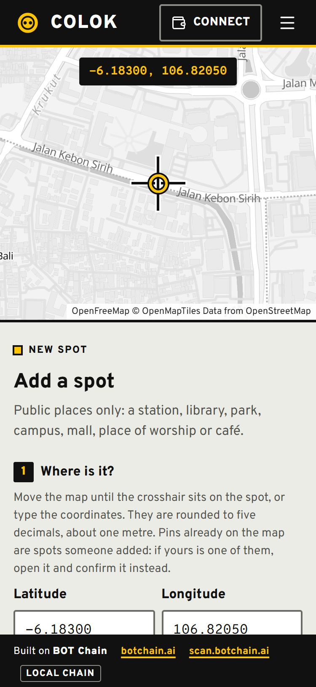 | 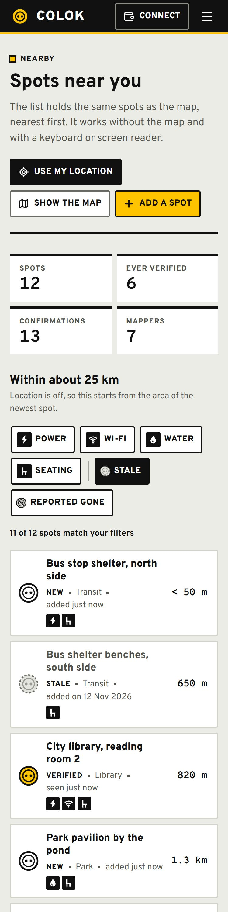 |

| Map at 768 px | Spot at 768 px |
|---|---|
| 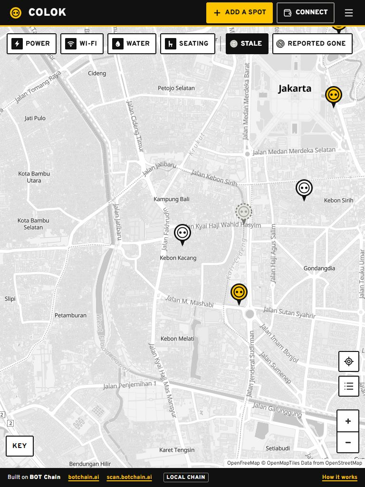 | 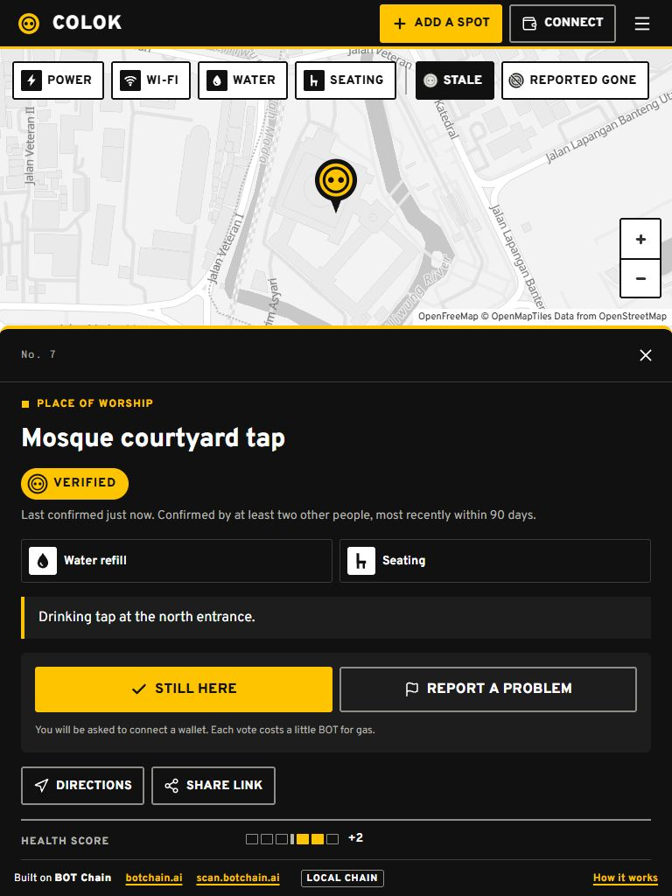 |

## Layout

```
calok/
├── contracts/   Hardhat project: Colok.sol, tests, deploy and seed scripts
├── docs/        README screenshots
└── web/         Vite + React + TypeScript + viem + MapLibre GL front end
```

## Run it locally

Requires Node 22.18 or newer (the geo parity test loads a TypeScript file directly).

```bash
# 1. A local chain on port 8547 (leave it running)
cd contracts
npm install
npx hardhat node --port 8547
```

```bash
# 2. In a second terminal: deploy, then add sample spots (local chain only)
cd contracts
npm run deploy:local
npm run seed:local
```

```bash
# 3. In a third terminal: the web app, at http://localhost:5175
cd web
npm install
npm run dev
```

The seed script adds eleven invented spots around central Jakarta and moves the local chain's clock 91 days forward halfway through, so the map shows every status (New, Verified, Stale, Reported gone). It refuses to run on any public network. The web app reads time from the chain, so "3 days ago" stays consistent after the jump.

On the local chain the wallet dialog lists four dev wallets (Moderator, Rani, Sari, Tono). They ask the Hardhat node to sign, so one wallet can add a spot and two others can confirm it without a browser extension. They exist only in the dev server; production builds do not contain them.

## Checks

```bash
cd contracts && npm test          # 70 tests: contract rules + geo parity with the web app
cd web && npm run typecheck       # TypeScript
cd web && npm run build           # production build into web/dist
```

## Which network the web app uses

| `VITE_CHAIN` | Network | Used by default in |
|---|---|---|
| `local` | Hardhat node, chain 31337, port 8547 | `npm run dev` |
| `testnet` | BOT Chain Testnet, chain 968 | — |
| `mainnet` | BOT Chain Mainnet, chain 677 | `npm run build` |

Contract addresses live in `web/src/config/deployments.json`. The deploy script fills in the right entry. Until an address is present for the active network, the site shows a "not deployed yet" notice.

## Map tiles

The map uses [OpenFreeMap](https://openfreemap.org) (Positron style) through MapLibre GL. It needs no account and no API key, allows commercial use and has no request limit on the public instance. Terms: <https://openfreemap.org/tos/>. The OpenMapTiles and OpenStreetMap credits are always shown on the map, uncollapsed, and repeated in the footer and on the About page.

MapLibre is loaded on demand, so the page frame and the nearby list appear first. If the tiles cannot load, the map area says so and points to the nearby list, which can do everything the map can: find, add (by typing coordinates or using device location), confirm and report.

The style URL is in `web/src/config/site.ts` (`TILES.style`) if the provider ever has to change.

## Deploy the contract

The deployer key stays on your machine.

```bash
cd contracts
cp .env.example .env      # then put the deployer key in .env as PRIVATE_KEY=0x...
npm run deploy:testnet    # BOT Chain Testnet (968) — test BOT from https://faucet.botchain.ai/basic
npm run deploy:mainnet    # BOT Chain Mainnet (677)
```

Deploying costs about 0.059 BOT at 20 gwei. Each deploy writes `contracts/deployments/<network>.json` and updates `web/src/config/deployments.json`; commit both so the site picks up the address. The deployer becomes the moderator (the only wallet that can hide a spot); `transferOwnership` can hand that role on.

Do not deploy to mainnet before the project's group exists: the program does not count projects that were on mainnet earlier. Real starting spots on mainnet must be places that exist and have been checked; the seed script is for the local chain only.

## Host the web app on Vercel

| Setting | Value |
|---|---|
| Root Directory | `web` |
| Framework Preset | Vite |
| Build Command | `npm run build` |
| Output Directory | `dist` |

No environment variables are needed for mainnet. Routes are hash-based (`#/spot/3`), so no rewrites are required.

## What the contract costs to use

Measured in the test suite, at 20 gwei:

| Action | Gas | BOT |
|---|---|---|
| Deploy | 2,948,363 | 0.059 |
| Add a spot, 48-byte name and 160-byte note, wallet's first action | 446,499 | 0.0089 |
| Add a spot, 24-byte name and 47-byte note, wallet's first action | 281,834 | 0.0056 |
| Add a spot, 28-byte name and 30-byte note, wallet already a mapper | 158,477 | 0.0032 |
| Still here, wallet's first action | 178,105 | 0.0036 |
| Still here, wallet already a mapper | 99,419 | 0.0020 |
| Report a problem, wallet's first action | 175,081 | 0.0035 |

Reading is free. A full map query (48 cells, 30 spots returned) estimates at about 0.67 M gas, well within a normal `eth_call` cap. The contract holds no funds and has no payable function.
